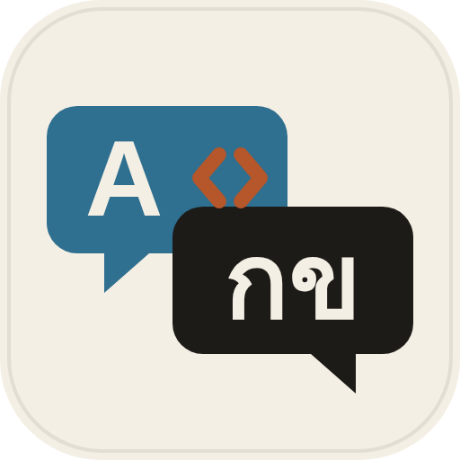
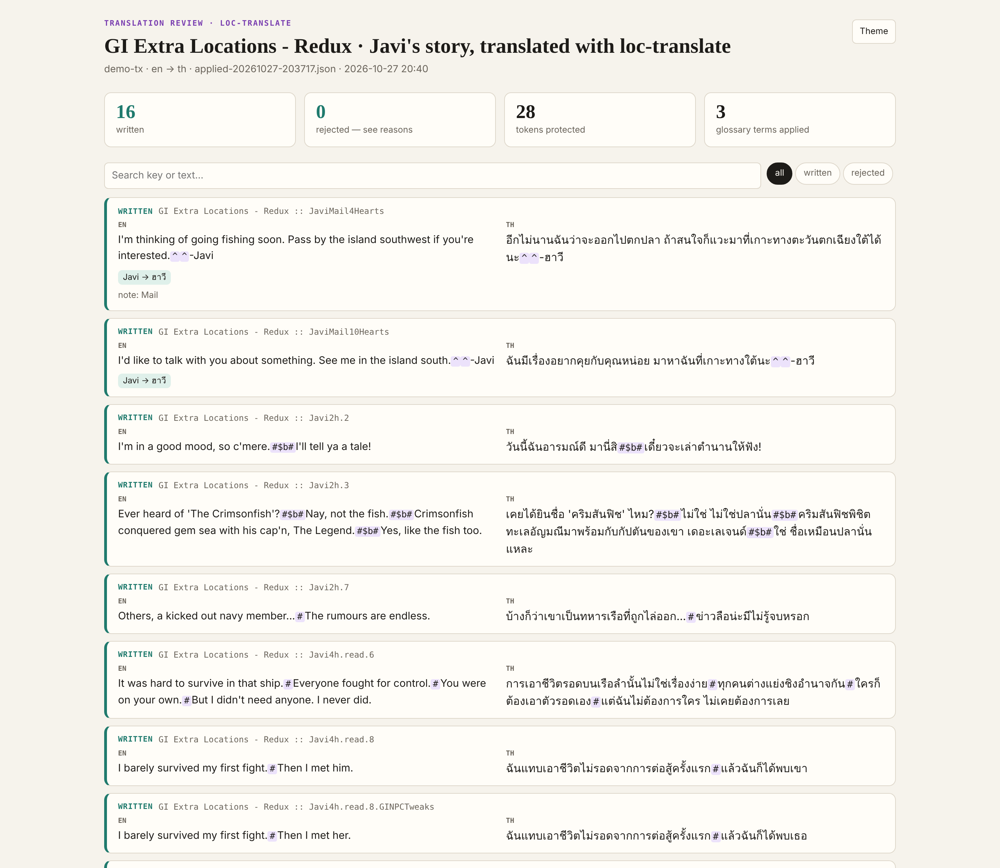
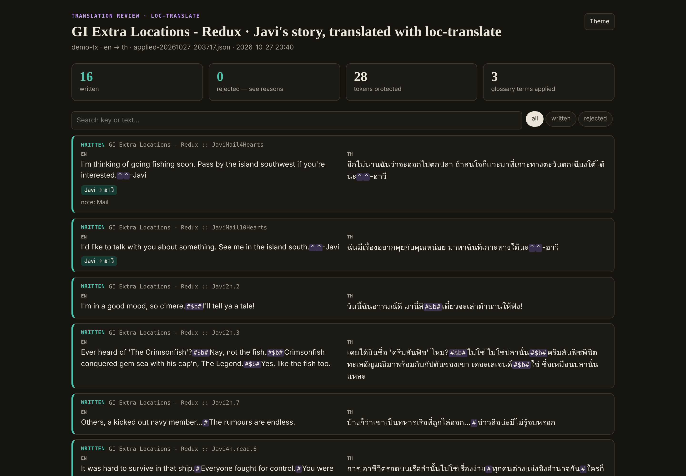
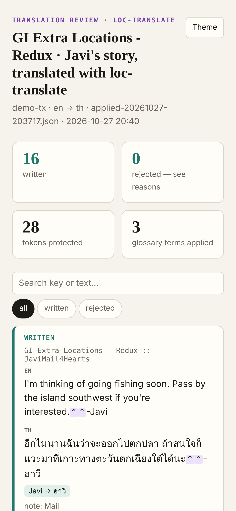

# Loc Translate

Translate game-mod and app locale files into any language without breaking a single token.

A free, open-source [agent skill](https://www.agensi.io/learn/skill-md-format) (SKILL.md) for translators of game mods and apps. Works with Claude Code, Codex CLI, Cursor, Gemini CLI and any agent that supports the SKILL.md standard.

## Screenshots

| Side-by-side review: every token highlighted, glossary terms checked | Dark mode |
|---|---|
|  |  |
| **Mobile** | |
|  | |

*Real output, not a mock-up:* 16 lines of Javi's story from **GI Extra Locations - Redux** translated to Thai in Javi's voice (ฉัน/คุณ, no ครับ), with every `#$b#`, `#`, `^` and `@` locked behind a placeholder and verified on the way back — 28 tokens protected, 0 rejected.

## What it does

- **Locks every token** (`{{x}}`, `#$b#`, `$h`, `@`, `^`, `%item … %%`, `{0}`, `%@`, tags…) behind numbered placeholders, then verifies count, order and dialogue structure before writing anything back. Lines that don't verify are rejected with the reason and retried.
- **Keeps the file intact:** translator comments, key order, trailing commas and formatting. New keys go where the source has them.
- **Context for the agent:** translator notes from comments, speaker hints from keys, glossary terms per line, a style guide for game dialogue and per-language notes.
- **Reuses translations:** identical strings already translated elsewhere are offered (or auto-filled with `--autofill-exact`).
- **Review page** (`l10n/review.html`) with source and translation side by side.

## Use the script directly

```bash
python3 scripts/loctx.py init --target th          # any language: ja, zh-CN, pt-BR, es…
python3 scripts/loctx.py scan                      # coverage per mod / file set
python3 scripts/loctx.py prepare                   # batches in l10n/work/
# the agent translates each batch
python3 scripts/loctx.py apply                     # verify + write; rejects come back as a retry batch
python3 scripts/loctx.py review                    # l10n/review.html
```

## Part of the Localization Kit

Four agent skills that share one project file (`.l10n.json`) and one glossary (`l10n/glossary.csv`):

| Skill | | What it does |
|---|---|---|
|  **loc-translate** | free | Translates locale files without breaking tokens, comments or layout |
|  [glossary-forge](https://github.com/AppleBoiy/glossary-forge) | free | Mines a glossary from existing translations and finds inconsistent terms |
| [loc-qa](https://www.agensi.io) | paid | Release check: broken tokens, structure, glossary, overflow, Thai particles — on one dashboard |
| [loc-sync](https://www.agensi.io) | paid | After the original updates: new, changed (stale) and removed strings, with word diffs |

Each skill also works on its own.

## Install

**Any agent through Agensi** — search for `loc-translate` on [agensi.io](https://www.agensi.io) and add it (free).

**Claude Code**

```bash
git clone https://github.com/AppleBoiy/loc-translate.git ~/.claude/skills/loc-translate
```

**Other agents** (Codex CLI, Cursor, Gemini CLI…) — copy the folder into the agent's skills directory.

Needs only Python 3.10+ — no packages, no network access, no API keys.

## Works with

- **SMAPI / Stardew Valley** `i18n/*.json` and Content Patcher packs — JSONC with comments, trailing commas, BOM and CRLF all kept as they are.
- **App locale files** (`en.json` → `th.json`, nested or flat): `{name}`, `{0}`, `%@`, `%d`, HTML tags and entities.
- Any target language. Extra care for **Thai** (combining marks, ครับ/ค่ะ by speaker, decomposed sara am) and other unspaced scripts.

Settings live in `.l10n.json`, created automatically and shared by every skill in the kit — see [`references/project-files.md`](references/project-files.md).

## Privacy and network

Runs fully offline. Reads and writes only inside your project folder (`l10n/` for work files and reports). The HTML reports are single files that make no network requests.

## Tests

```bash
python3 -m unittest discover -s tests -v   # synthetic "Moonlit Orchard" mod + app fixtures
python3 tools/package.py                    # builds dist/<skill>.zip (single-file script for Agensi)
```

## Licence

[MIT](LICENSE)
